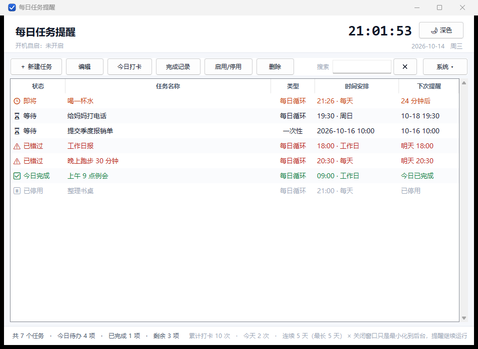
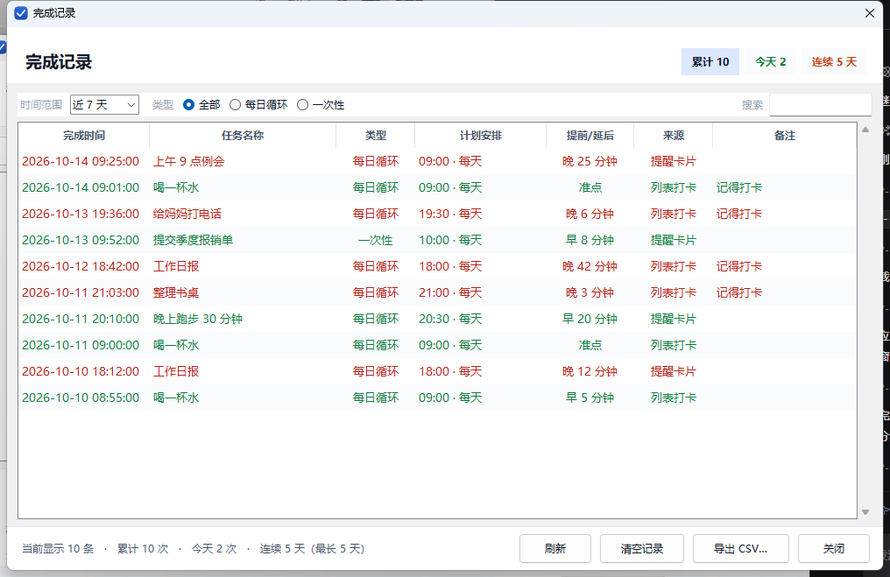
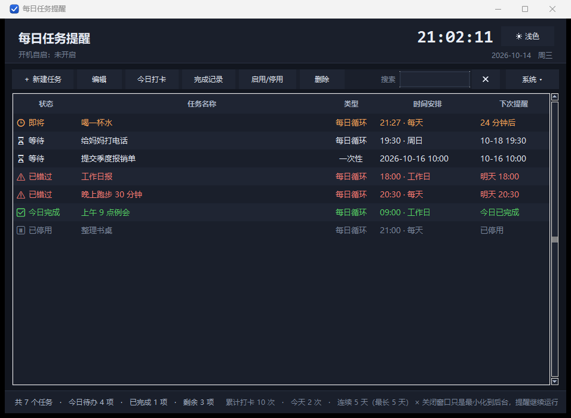

# 每日任务提醒

一个轻量的 **Windows 桌面任务提醒小程序**，支持 **每日循环任务** 和 **一次性任务**。
纯 Python 标准库（tkinter）实现，不需要安装任何第三方依赖，双击即用。



---

## 一、快速开始

| 文件 | 用途 |
| --- | --- |
| **`启动任务提醒.vbs`** | **双击这个运行程序**（正常打开主窗口，不弹黑色命令行） |
| `后台静默启动.vbs` | 启动后只驻留后台，不弹窗口（用于开机自启 / 放进「启动」文件夹） |
| `启动任务提醒.bat` | 命令行启动，出错时会打印信息，方便排查 |
| `main.py` | 程序入口，可用 `python main.py` 直接运行 |
| `build_exe.bat` | 一键打包成单文件 `DailyTaskReminder.exe`（需要联网装 PyInstaller） |

运行环境：Windows 10 / 11 + Python 3.9 或更高版本（安装时勾选 **Add Python to PATH**）。
程序只用标准库，**不需要 pip install 任何东西**。

### 三种启动方式的区别

| 启动方式 | 行为 |
| --- | --- |
| 双击 `启动任务提醒.vbs`（或桌面快捷方式） | **总是显示主窗口**，不管有没有开自启 |
| 开机自启（注册表项带 `--silent`） | 开机时只在后台驻留，不弹窗口，提醒照常 |
| `后台静默启动.vbs` | 手动启动也只驻留后台 |

程序已经在后台驻留时，你**再双击一次**启动器，它不会重复开一个（第二个进程会立刻退出），
而是把已有的窗口**叫到最前面**。

程序在后台且窗口没显示时，用 `Ctrl+Alt+Del` 之类也能看到它在运行；
想确认它在跑，看任务栏右下角有没有提醒弹窗即可。

---

## 二、功能

### 任务类型

* **每日循环任务** —— 每天到点提醒；可以进一步限定只在「周一、周三、周五」或「工作日」提醒。
* **一次性任务** —— 指定某个日期 + 时间，只提醒一次（例如「10 月 20 日 14:00 开会」）。

### 提醒方式（三重保障）

1. **右下角弹窗卡片**：置顶显示，带「稍后 5 分钟 / 标记完成 / 知道了」按钮；
2. **Windows 系统通知**：进入右下角通知中心，错过也能回看；
3. **提示音**：`winsound` 系统提示音。

### 其它

* **完成记录（打卡历史）**：每次打卡都留下带时间的记录，可统计连续天数、导出 CSV
* **深色模式**：一键切换，护眼，设置会被记住
* 今日待办统计：`共 N 个任务 · 今日待办 X 项 · 已完成 Y 项 · 剩余 Z 项`
* 今日打卡 / 取消打卡；启用 / 停用某个任务
* 搜索过滤、右键菜单、快捷键
* **开机自动启动**（写入 `HKCU\...\Run`，不需要管理员权限）
* 导入 / 导出任务（JSON，方便备份和换机）
* 关窗即最小化到后台，提醒继续工作；想真正退出用菜单「系统 → 退出」

---

## 三、完成记录（打勾记录）

点工具条上的「完成记录」（快捷键 `Ctrl+H`）打开：



* 每次「今日打卡」或点提醒卡片上的「标记完成」都会写入一条记录，带**完成时间**与**来源**（列表打卡 / 提醒卡片）；
* 自动算出这次是**准点、提前还是延后**（绿色=提前，红色=延后）；
* 支持按**时间范围**（今天 / 近 7 天 / 近 30 天 / 近 90 天 / 全部）、**任务类型**、**关键词**筛选；
* 顶部徽章与底部汇总显示：累计打卡次数、今天次数、**连续打卡天数**、历史最长连续天数；
* 「导出 CSV…」可导出当前筛选结果（Excel 可直接打开）；
* 撤销打卡会自动删掉对应那条记录，不会留下假数据。

记录保存在 `%APPDATA%\DailyTaskReminder\history.json`，默认保留最近 400 天。

---

## 四、深色模式

点右上角的「🌙 深色 / ☀ 浅色」按钮，或菜单「系统 ▾ → 深色模式」，也可以按 `Ctrl+L`。



* 主界面、提醒卡片、编辑对话框、完成记录窗口会一起换色；
* 深色下会自动切换到可自定义颜色的 ttk 主题（`clam`），浅色下用 Windows 原生外观；
* 选择会被记住，下次启动保持同样配色。

---

## 五、快捷键

| 按键 | 功能 |
| --- | --- |
| `Ctrl + N` | 新建任务 |
| `Enter` / 双击 | 编辑选中任务 |
| `空格` | 今日打卡 / 取消打卡 |
| `Delete` | 删除任务 |
| `Ctrl + D` | 启用 / 停用 |
| `Ctrl + H` | 打开完成记录 |
| `Ctrl + L` | 切换深色模式 |
| `Ctrl + R` | 立即检查一次提醒 |
| `F5` | 刷新列表 |
| `Esc` | 最小化到后台 |

---

## 六、数据与备份

所有数据都存在本机用户目录：

```
%APPDATA%\DailyTaskReminder\tasks.json      任务数据
%APPDATA%\DailyTaskReminder\history.json    打卡记录
%APPDATA%\DailyTaskReminder\settings.json   程序设置（含深色模式）
```

* 菜单「系统 → 打开数据目录」可直接打开该文件夹；
* 想换电脑或备份，用「系统 → 导出任务…」，在新机器上「导入任务…」即可；打卡记录可在完成记录窗口「导出 CSV…」；
* 文件损坏时会自动备份为 `tasks.bad.json` / `history.bad.json` 并重新开始，不会静默丢数据。

---

## 七、开机自启（两种方式，任选其一）

1. **程序内设置**：点「系统 ▾ → 开机自动启动」，程序会把自启项写入注册表
   `HKCU\Software\Microsoft\Windows\CurrentVersion\Run`，无需管理员权限。
   写入的命令带 `--silent`，所以**开机时只在后台驻留**；你手动双击启动器仍然会显示窗口。
2. **启动文件夹**：把 `后台静默启动.vbs` 的快捷方式放进
   `%APPDATA%\Microsoft\Windows\Start Menu\Programs\Startup`。

> 想取消：再次点掉菜单里的勾选，或删掉启动文件夹里的快捷方式。
> 查当前自启命令：`reg query HKCU\Software\Microsoft\Windows\CurrentVersion\Run /v DailyTaskReminder`

---

## 八、打包成免安装 EXE（可选）

如果希望目标电脑上不装 Python，就在**能联网**的机器上执行：

```bat
build_exe.bat
```

产物为单文件：`dist\DailyTaskReminder.exe`，可直接双击或复制到任意位置运行。
打包脚本会自动生成图标并带上 `--windowed`（无控制台窗口）。

手动打包也可以：

```bat
python -m pip install pyinstaller
python tools\make_icon.py
python -m PyInstaller --noconfirm --clean --onefile --windowed ^
  --name DailyTaskReminder --icon app.ico --add-data "app.ico;." main.py
```

---

## 九、目录结构

```
main.py                     程序入口（单实例、开机自启参数、--show/--silent）
daily_task/
  tasks.py                  任务模型 + JSON 持久化 + 到点判断
  history.py                完成记录（打卡历史）+ 统计 + CSV 导出
  notify.py                 系统通知 / 右下角弹窗 / 提示音
  settings.py               设置读写 + 注册表开机自启
  ui.py                     主界面、完成记录窗口、主题、编辑对话框、提醒调度
tools/
  make_icon.py              生成 app.ico
  make_shortcut.py          创建桌面 / 启动文件夹快捷方式
  fix_vbs_encoding.py       把 .vbs 转成 UTF-16LE（中文不乱码）
  grab_window.ps1           截图辅助（开发用）
tests/
  smoke_test.py             模型 + 界面 + 序列化 + 设置开关 + 单实例
  launch_test.py            启动方式（手动可见 / 自启静默 / 再次双击唤起）
  scheduler_test.py         调度行为（到点 / 不重复 / 停用 / 稍后 / 星期限定）
  history_test.py           完成记录与深色模式
  e2e_test.py               端到端：打卡 → 重启恢复 → 撤销 → 导出
  inspect_widgets.py        控件树查重（防止界面出现两套控件）
  shortcut_test.py          快捷方式创建
  hold_window.py            常驻窗口（配合截图，开发用）
启动任务提醒.vbs            双击运行
后台静默启动.vbs            静默驻留
启动任务提醒.bat            命令行运行
build_exe.bat               打包 EXE
```

---

## 十、自检

```bat
python tests\smoke_test.py        :: 模型 + 界面 + 序列化 + 设置开关 + 单实例
python tests\launch_test.py       :: 手动启动可见 / 开机自启静默 / 再次双击唤起窗口
python tests\scheduler_test.py    :: 到点提醒 / 不重复提醒 / 打卡后停止 / 停用 / 稍后提醒 / 自动完成 / 星期限定
python tests\history_test.py      :: 打卡记录 / 撤销 / 统计 / 连续天数 / 筛选 / 提前延后 / CSV / 深色模式
python tests\e2e_test.py          :: 端到端（打卡 → 保存 → 重启恢复 → 撤销 → 导出）
python tests\inspect_widgets.py   :: 查控件树里有没有重复的按钮/文字
python tests\shortcut_test.py     :: 快捷方式创建
```

`smoke_test.py` 会验证：JSON 往返、到点判断、打卡 / 取消、启停、搜索、稍后提醒、编辑对话框构建、注册表自启读写、单实例互斥体。

截图（开发用）：

```bat
python tests\hold_window.py --history --dark
pwsh -File tools\grab_window.ps1 -ProcessName python -Out shot.png -MinWidth 600
```

## 十一、常见问题

**Q：双击 `启动任务提醒.vbs` 没反应？**
先双击 `启动任务提醒.bat`，它会打印具体错误（多半是没装 Python 或没勾选 Add Python to PATH）。
如果程序其实已经在后台运行，再双击一次会把它的窗口**叫到最前面**（不会重复开一个）。
仍然没反应的话，看看任务管理器里有没有 `pythonw.exe`：
有的话说明程序在后台正常跑着，只是窗口没显示 —— 用 `python main.py --show` 可以强制把窗口显示出来。

**Q：怎么确认它到底有没有在跑？**
任务管理器里找 `pythonw.exe`；或者直接再双击一次启动器，窗口应该会跳到最前面。
命令行加 `--show` 也能强制显示窗口：`pythonw main.py --show`

**Q：开机自启之后每次开机都弹出窗口？**
不应该。自启项里带 `--silent`，开机只在后台驻留。
可以执行 `reg query HKCU\Software\Microsoft\Windows\CurrentVersion\Run /v DailyTaskReminder`
确认命令结尾有 `--silent`；没有的话，在程序里把「开机自动启动」取消再勾选一次即可刷新。

**Q：关掉窗口后任务还会提醒吗？**
会。点 × 只是最小化到后台，程序仍在运行。要真正退出请用菜单「系统 → 退出」。

**Q：怎么确认开机自启真的生效？**
菜单「系统 ▾ → 开机自动启动」打勾后，标题栏下方会显示状态；也可以用
`reg query HKCU\Software\Microsoft\Windows\CurrentVersion\Run /v DailyTaskReminder` 查看。

**Q：错过时间的任务还会提醒吗？**
每日任务只在到点后 8 分钟内提醒（避免开电脑被一堆过期提醒轰炸），错过的会显示为「已错过」，下次照常；
一次性任务即使启动晚了也会补提醒一次，不会漏。

**Q：打卡打错了怎么办？**
再点一次「今日打卡」即可取消，对应的那条完成记录会一起删掉。

**Q：深色模式下按钮还是浅色？**
程序会在深色时自动切到可自定义颜色的 ttk 主题；如果你改过系统主题导致显示异常，
点「系统 ▾ → 深色模式」关掉再打开一次即可重新套用。
